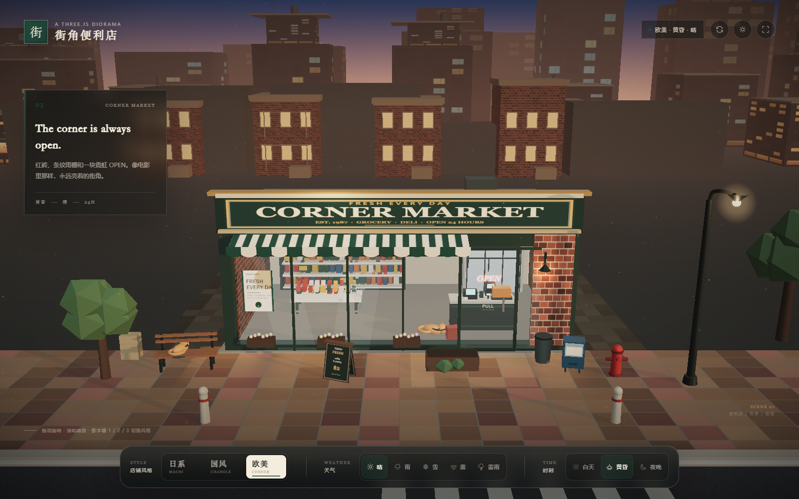

# 街角便利店 · three.js 场景

一个不用构建、打开即看的 three.js 微缩街角便利店。可切换 **日系 / 国风 / 欧美** 三种店铺风格，并调节 **晴 / 雨 / 雪 / 雾 / 雷雨** 与 **白天 / 黄昏 / 夜晚**。



## 快速开始

需要 [Node.js](https://nodejs.org/) 18 或更高版本（仅用于启动本地静态服务器，场景本身没有 npm 依赖）。

- Windows：双击 `start.bat`
- 命令行：

```bash
npm start
```

浏览器会自动打开 `http://127.0.0.1:4173/`。如果端口被占用：

```bash
PORT=5173 npm start
```

> 不能直接双击 `index.html`：场景使用 ES Modules，浏览器要求通过 HTTP 访问。`server.mjs` 只负责托管本地文件，three.js 已经放在 `vendor/` 中，**断网也能运行**。


## 操作

| 操作 | 效果 |
| --- | --- |
| 拖动 / 滚轮 | 360° 自由环绕 / 缩放 |
| `1` `2` `3` | 切换日系、国风、欧美 |
| `R` | 重置视角 |
| 底部控制栏 | 切换风格、天气、时刻 |
| 右上角按钮 | 自动环绕、重置视角、全屏 |

## 场景里有什么

- **日系**：白底红字的マチマート灯箱、蓝のれん、竖招牌、自动贩卖机、邮筒、樱花树、电线杆与低层町屋。
- **国风**：朱红木柱、青瓦飞檐、长乐便利金字匾、红灯笼、竹丛、蒸笼小吃车、石鼓与月亮门。
- **欧美**：红砖店面、绿白条纹雨棚、CORNER MARKET 手绘招牌、霓虹 OPEN、长椅、消防栓、报箱与褐石街区。
- **共用内部**：商品陈列架、冷柜、收银台、热食柜、咖啡机、菜单板、吊灯、店猫，以及从门口洒到人行道上的暖光。
- **城市纵深**：近景商铺、中景公寓、远景高楼和完整天际线，四周都有建筑收边，360° 环绕也不会露出空地平线。
- **街区细节**：正对店门的规范斑马线、路缘石、路灯、行道树、停靠车辆，以及带员工通道、空调、垃圾桶和送货车的后巷。
- **门面文字**：日系のれん、国风匾额和欧美招牌/门贴都按门框居中，不偏移、不溢出。
- **天气**：雨线、地面积水与涟漪、飘雪与屋顶/地面积雪、地面雾团、雷雨闪电；风会影响雨雪、灯笼、雨棚和热气。
- **时刻**：天空渐变、太阳/月亮、星空、室内外灯光与招牌亮度都会变化；黄昏是默认时刻。

三种风格会替换建筑、招牌、街道道具、背景街区与店内配色，天气和时刻状态会保留。

## 通过 URL 直接打开某个组合

```text
?style=jp|cn|us&time=day|dusk|night&weather=clear|rain|snow|fog|storm
```

例如：

- 国风 · 夜 · 雨：`http://127.0.0.1:4173/?style=cn&time=night&weather=rain`
- 欧美 · 黄昏 · 雪：`http://127.0.0.1:4173/?style=us&time=dusk&weather=snow`

## 文件结构

```text
03-最终成品/
├─ index.html          页面与 UI 结构
├─ styles.css          界面样式、响应式布局
├─ src/
│  ├─ main.js          场景初始化、交互、渲染循环
│  ├─ store.js         便利店建筑、招牌、店内与街区
│  ├─ props.js         货架、冷柜、灯笼、长椅等道具
│  ├─ sky.js           天空、太阳/月亮、云、星空、闪电
│  ├─ weather.js       雨、雪、雾、积水、涟漪
│  ├─ textures.js      Canvas 程序化贴图
│  └─ util.js          通用工具
├─ vendor/three/       本地 three.js r169 及所需 addons
├─ server.mjs          零依赖静态服务器
├─ start.bat           Windows 一键启动
└─ preview.png         场景预览图
```

## 调整建议

- 改风格文案和配色：`src/store.js` 顶部的 `STYLES`。
- 改默认风格 / 时刻 / 天气：`src/store.js` 与 `src/main.js` 中的初始参数。
- 改店面尺寸和布局：`src/store.js` 的 `FRONT_Z`、`buildShell()`、`buildFrontStyle()`。
- 改天气强度与转场速度：`src/weather.js` 的 `WEATHER_TARGETS` 与 `update()`。
- 改天空色板：`src/sky.js` 的 `TIME_PRESETS`。

## 技术说明

- three.js r169，本地 vendored，不依赖 CDN。
- 使用 `EffectComposer + UnrealBloomPass + OutputPass` 做轻微泛光；ACES Filmic tone mapping。
- 阴影为单个方向光 + PCF Soft Shadow；室内点光不投影，以控制移动端性能。
- 程序化 Canvas 贴图，无外部图片资源。
- 响应式相机：桌面与竖屏手机会使用不同的 FOV / 机位。
- 画面主体是实时渲染，不是视频或图片。

Three.js 采用 MIT License；场景代码与美术为本项目原创。
